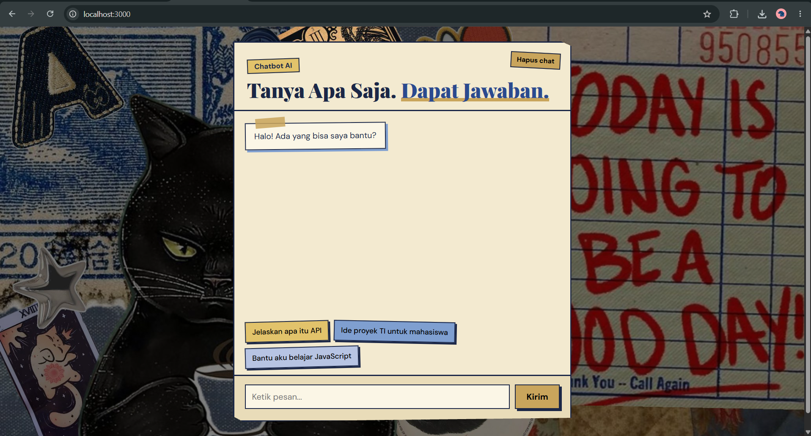
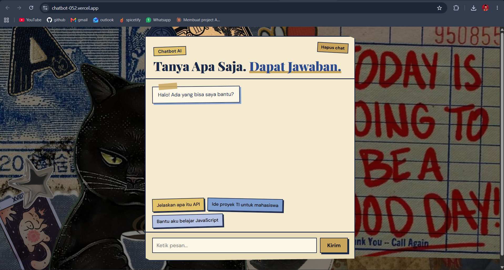

# Chatbot AI (P10)

Chatbot sederhana berbasis Express yang terhubung ke OpenRouter, dengan respons yang tampil secara streaming dan antarmuka bergaya collage art.

## Tampilan

### Local (localhost:3000)


### Vercel
Demo: https://chatbot-052.vercel.app



## Teknologi
- Node.js dan Express
- dotenv untuk menyimpan API key
- OpenRouter API (model gratis `inclusionai/ling-3.2-flash:free`)
- HTML, CSS, dan JavaScript murni untuk tampilan

## Cara menjalankan
1. Install dependensi:
   ```
   npm install
   ```
2. Salin `.env.example` menjadi `.env`, lalu isi API key OpenRouter kamu:
   ```
   OPENROUTER_API_KEY=api_key_kamu
   ```
3. Jalankan server:
   ```
   npm start
   ```
4. Buka `http://localhost:3000` di browser.

## Struktur folder
```
P10/
├── docs/
│   ├── screenshot-local.png
│   └── screenshot-vercel.png
├── public/
│   ├── css/style.css
│   ├── js/script.js
│   ├── src/background.jpg
│   └── index.html
├── .env.example
├── .gitignore
├── index.js
└── package.json
```

## Catatan
File `.env` tidak ikut ke GitHub supaya API key tetap aman.